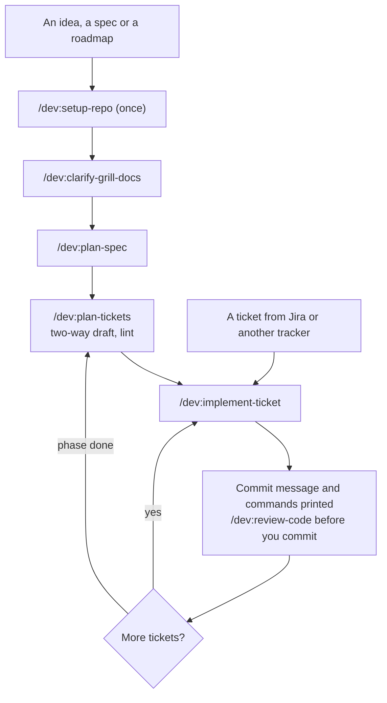

<div align="center">


# Skills for Standard Developer

**From an empty source, or a ticket in a big project, to delivery.**

[](https://code.claude.com/docs/en/plugins)
[](CHANGELOG.md)
[](https://nodejs.org)
[](LICENSE)

[Quick start](#quick-start) · [How it works](#how-it-works) · [Skills](#skills) · [Changelog](#changelog)

</div>

---

36 small skills for Claude Code that help you agree on what to build, cut it into tickets, prove it works, and remember what the last session learned. Skills with a common job share a prefix: type `/dev:clarify-` or `/dev:test-` to list them.

## Why this plugin

- **Proof, not claims.** A ticket is done when a command on the real code says so, with a `VERIFIED` verdict, not when the agent says it is.
- **Process sized to risk.** A one-line change runs the existing build and nothing more. Stored data, outside callers and money get tests per risk and a review of what the change breaks outside its diff.
- **Plans checked before code.** Larger epics are drafted forward and backward and compared, and every breakdown is linted before a ticket is worked.
- **You stay in control.** Skills print commit, push and tracker commands for you to run. They stop only for an ambiguous requirement, a real choice, or something git cannot undo.
- **Memory across sessions.** Issues, attempts, fixes and decisions are kept in a local SQLite store and found again by the next session.

## Quick start

```bash
claude plugin marketplace add nhhthong/skills
claude plugin install dev@nhhthong-skills
```

Then, inside your project:

```text
/dev:setup-repo                      once per repo: storage, delivery, tracker
/dev:implement-ticket <ticket text>  take one ticket to a printed commit
/dev:ask-me <what you want to do>    not sure? get the skills to run, in order
```

> **Requires** [Node.js](https://nodejs.org) 22.18+ for the memory server. Without it, skills still work and memory falls back to `.work/notes.md`.

## How it works



`/dev:implement-ticket` takes one ticket through seven steps: identify, orient, fill the gaps, plan the proof, build, review, deliver. It writes a `Step:` line before each one, so a session that dies resumes with `/dev:implement-ticket`.

The proof tier decides how much of that runs:

| Tier | When | What runs |
|---|---|---|
| `check` | A mistake shows at a glance and a revert undoes it | The repo's existing command; no new test, no review stop |
| `light` | As above, with one behaviour worth keeping | One test, a baseline of the touched area |
| `full` | Data stored or sent, an outside caller, money, auth | Tests per risk, a full-suite baseline, the Impact review |

## Skills

Prefix every name with `/dev:`. **You type** skills run only when you call them. **Agent** skills also start on their own when the task fits. Open a group to see its skills.

<details>
<summary><b>Setup</b>: prepare a repo, a machine and a way to drive the app (3)</summary>

- [`setup-repo`](skills/setup-repo/SKILL.md) (you type): Choose where memory lives (in the repo or private), how work is delivered, the issue tracker and domain docs.
- [`setup-need-install`](skills/setup-need-install/SKILL.md) (you type): Check which helper tools are installed, look at the project, and recommend which to add.
- [`setup-verify`](skills/setup-verify/SKILL.md) (you type): Generate a project skill that launches the real app, drives a feature like a user and keeps the evidence; `refresh` keeps it in line with the code.

</details>

<details>
<summary><b>Clarify</b>: agree on what to build (5)</summary>

- [`clarify-grill-docs`](skills/clarify-grill-docs/SKILL.md) (you type): Interview you until the design is settled, building a shared language and recording decisions as they settle.
- [`clarify-ask`](skills/clarify-ask/SKILL.md) (you type): Turn a question you cannot answer alone into a questionnaire for the person who can.
- [`clarify-explain`](skills/clarify-explain/SKILL.md) (you type): Ask the agent to re-pitch a message that did not land, in plain English and the project's terms.
- [`clarify-grill`](skills/clarify-grill/SKILL.md) (agent): The interview itself: rounds of questions, each with a recommended answer.
- [`clarify-domain`](skills/clarify-domain/SKILL.md) (agent): Challenge terms against the glossary, test edge cases, and record each term and decision once.

</details>

<details>
<summary><b>Explore</b>: answer a question before building (4)</summary>

- [`explore-decide`](skills/explore-decide/SKILL.md) (agent): Research a technical choice and recommend one option; also picks infrastructure one component at a time.
- [`explore-research`](skills/explore-research/SKILL.md) (agent): Investigate a question against primary sources and save cited findings; uses Context7 first when present.
- [`explore-prototype`](skills/explore-prototype/SKILL.md) (agent): Build a throwaway prototype to answer a design question.
- [`explore-why`](skills/explore-why/SKILL.md) (agent): Find why existing code is shaped the way it is, from git history, pull requests, tickets and memory, keeping what is known apart from what is inferred.

</details>

<details>
<summary><b>Plan</b>: from source to tickets (3)</summary>

- [`plan-spec`](skills/plan-spec/SKILL.md) (you type): Index a structured source by requirement code, or write a full spec from a conversation; open points stay open.
- [`plan-tickets`](skills/plan-tickets/SKILL.md) (you type): Cut epics if needed, then tracer-bullet tickets with types, requirement codes, blocking edges, files and proof; a larger epic is drafted forward and backward and compared, and every breakdown is linted.
- [`plan-ticket-change`](skills/plan-ticket-change/SKILL.md) (you type): Split a ticket in two, cancel it, or reopen it, keeping ids, blocking edges, the spec index and memory in step.

</details>

<details>
<summary><b>Implement</b>: build (2)</summary>

- [`implement-ticket`](skills/implement-ticket/SKILL.md) (you type): Take one ticket from orientation to a printed commit message and commands; resumes unfinished work.
- [`implement-spec`](skills/implement-spec/SKILL.md) (you type): Implement a whole spec with parallel subagents, one frontier at a time.

</details>

<details>
<summary><b>Test</b>: right-sized proof (3)</summary>

- [`test-plan`](skills/test-plan/SKILL.md) (agent): Choose the minimum proof a ticket needs: an existing command, one test, or tests per risk.
- [`test-tdd`](skills/test-tdd/SKILL.md) (agent): Red-green-refactor one slice at a time, at named seams.
- [`test-benchmark`](skills/test-benchmark/SKILL.md) (agent): Vet a performance number before it is reported or acted on: limiter, tuning, errors, repeat runs, end-to-end share.

</details>

<details>
<summary><b>Debug</b>: find the cause of a hard bug (1)</summary>

- [`debug-diagnose`](skills/debug-diagnose/SKILL.md) (agent): Build a loop that goes red on the bug, then minimise, hypothesise, fix, and record every attempt.

</details>

<details>
<summary><b>Review</b>: check the work (4)</summary>

- [`review-code`](skills/review-code/SKILL.md) (you type): Review a diff on separate axes in parallel subagents: Standards, Spec, and Impact for risky changes; each finding sorted into act on, consider, noted or dismissed.
- [`review-impact`](skills/review-impact/SKILL.md) (agent): Find what a change breaks outside its diff, and prove the fact that makes it safe by running real code.
- [`review-learn`](skills/review-learn/SKILL.md) (you type): Write a short learning note for a finished ticket or epic, with Mermaid diagrams, under `.work/learn/`.
- [`review-pr`](skills/review-pr/SKILL.md) (agent): Shape a pull request body: a summary visual, before and after evidence, merge danger.

</details>

<details>
<summary><b>Design</b>: deep modules, clean seams (2)</summary>

- [`design-improve`](skills/design-improve/SKILL.md) (you type): Scan the code for places to deepen modules and walk through the one you pick.
- [`design-modules`](skills/design-modules/SKILL.md) (agent): The vocabulary for deep modules, seams and testable interfaces, with red flags for code agents extend.

</details>

<details>
<summary><b>Session</b>: status, handoff, retrospective (3)</summary>

- [`session-progress`](skills/session-progress/SKILL.md) (you type): Report where the work stands, what is open, what looks wrong and what to do next.
- [`session-handoff`](skills/session-handoff/SKILL.md) (you type): Compact the conversation into a document another agent can continue from.
- [`session-retro`](skills/session-retro/SKILL.md) (you type): After a session, suggest improvements to the agent's environment, most severe first.

</details>

<details>
<summary><b>Memo</b>: remember and recall across sessions (2)</summary>

- [`memo-post`](skills/memo-post/SKILL.md) (agent): Record an issue, a tried approach, a fix, a decision with its reason, or a lesson.
- [`memo-callback`](skills/memo-callback/SKILL.md) (agent): Search earlier issues, fixes, decisions and notes by question, ticket, epic or file.

</details>

<details>
<summary><b>Other</b>: navigation, manual steps, writing for agents (4)</summary>

- [`help`](skills/help/SKILL.md) (you type): Show what each skill does, one line each, for all or one group.
- [`ask-me`](skills/ask-me/SKILL.md) (you type): Say what you want to do and get the skills to run, in order.
- [`wizard`](skills/wizard/SKILL.md) (you type): Generate an interactive script that walks you through steps only a human can do.
- [`agent-docs`](skills/agent-docs/SKILL.md) (agent): Write skills, `CLAUDE.md` and other documents agents read.

</details>

## What needs you

| | |
|---|---|
| **Skills ask you** | when a requirement is ambiguous, when more than one option fits, during `setup-repo`, `setup-need-install` and `session-retro`, and before anything on the `Always pause` list: deleting data, a migration on a shared database, a force-push, a deploy, a message to a customer |
| **Skills print, you run** | `git commit` and `git push` (set `Git writes: run` in `workflow.md` to let skills run them; your `.claude/settings.json` rules still apply), and every `gh` or `glab` write, always |
| **Skills just do** | read code and history, write files under `.work/`, run tests and builds, create branches and worktrees |

## Files the skills write

Tickets, the spec index, plans, proof scripts and notes go under `.work/` in the project. Under `private` storage, `.work/` stays out of git and nothing else in the repo is touched.

## Memory

A local MCP server, `memo`, keeps issues, attempts, fixes and decisions in SQLite at `~/.claude/memo/`, one file per project, so the next session finds them. No network. Back it up with `node mcp/memo/cli.ts export` from the plugin folder.

## Changelog

<details>
<summary><b>2.0.1</b> (2026-10-27): fewer stops, more accurate plans</summary>

- A skill asks only when a criterion is ambiguous or more than one option fits; `test-plan` checks itself instead of asking.
- `plan-tickets` drafts an epic forward and backward and compares them, then lints the breakdown (`check-tickets.mts`).
- Tickets carry `Files:` and `Proof:` lines; `implement-ticket` stops when the plan proves wrong.
- `gh` and `glab` writes are always printed, never run.

</details>

<details>
<summary><b>2.0.0</b> (2026-10-27): proof-first skills from pstack</summary>

- New skills `review-impact`, `explore-why`, `test-benchmark`, `setup-verify`.
- Rigor follows the ticket's tier; proof runs on the real artifact.
- `review-code` adds an Impact axis for risky changes.

</details>

Full history: [CHANGELOG.md](CHANGELOG.md).

## Development

```bash
npm install && npm test   # skill consistency check, then the script tests
```

`npm test` names whatever a new skill is missing: its `SKILL.md`, `agents/openai.yaml`, or its line in `plugin.json`, `skills/help/SKILLS.md` and this README.

## Credits

- [Matt Pocock's skills](https://github.com/mattpocock/skills) (MIT): the base of this repo.
- [pstack](https://github.com/cursor/plugins/tree/main/pstack) by Lauren Tan (MIT): proof levels, tier-gated rigor, leaf files, two-way planning, and the skills behind `review-impact`, `explore-why`, `test-benchmark` and `setup-verify`.

## License

[MIT](LICENSE). Copyright (c) 2026 Matt Pocock and nhhthong.
