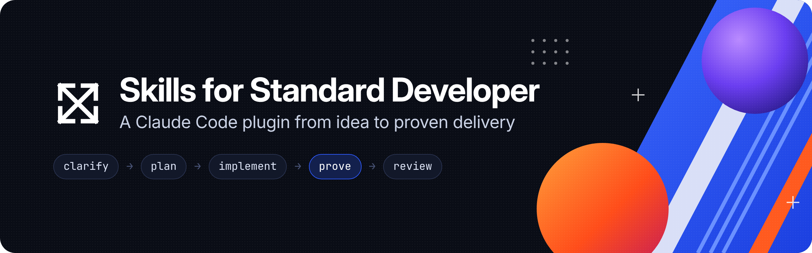
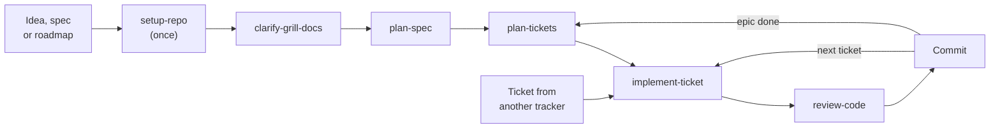

<div align="center">



<br>

[](https://code.claude.com/docs/en/plugins)
[](CHANGELOG.md)
[](#skill-catalog)
[](https://nodejs.org)
[](LICENSE)

**From an empty folder, or one ticket in a large codebase, to a delivery you can prove.**

[Quick start](#quick-start) · [How it works](#how-it-works) · [Resume in a new session](#resume-in-a-new-session) · [Skill catalog](#skill-catalog) · [Changelog](CHANGELOG.md)

</div>

---

## Overview

`dev` is a Claude Code plugin of 35 small skills that give an agent a repeatable way to work: agree on what to build, cut it into tickets, build each one against a proof, review it, and leave a record the next session can pick up. Skills that share a job share a prefix, so `/dev:clarify-` or `/dev:test-` lists them.

| | |
|---|---|
| **Proof, not claims** | A ticket is done when a command on the real code prints `VERIFIED`, and that command was seen failing first. |
| **Process sized to risk** | A one-line change runs the existing build. Stored data, outside callers and money get tests per risk and a deeper review. |
| **Plans checked before code** | Every ticket breakdown is linted; large or entangled epics are drafted forward and backward and compared. |
| **Cheap to resume** | One command prints where the work stands; one more prints everything a single ticket needs. |
| **You choose the autonomy** | `micromanagement` asks at every real choice and prints git commands for you. `empowerment` decides, logs each choice as `ASK:`, commits and keeps going. Both stop before anything on the `Always pause` list. |
| **Nothing to install** | The skills are Markdown. Node.js is used only by the ticket linter and the state command. |

## Quick start

```bash
claude plugin marketplace add nhhthong/skills
claude plugin install dev@nhhthong-skills
```

Then, inside your project:

```text
/dev:setup-repo                      once per repo: storage, delivery, tracker, mode
/dev:implement-ticket <ticket text>  take one ticket to a verified commit
/dev:ask-me <what you want to do>    not sure? get the skills to run, in order
```

<details>
<summary>Typical routes</summary>

| Situation | Run |
|---|---|
| An idea or a requirements document, no code yet | `setup-repo` → `clarify-grill-docs` → `plan-spec` → `plan-tickets` → `implement-ticket` |
| A ticket from Jira or another tracker, in a large repo | `setup-repo` (private storage) → `implement-ticket` with the pasted ticket |
| Back after a break, or a session died | `session-progress` → `implement-ticket` with no argument |
| A hard bug | describe it; `debug-diagnose` starts on its own |
| Before committing | `review-code` |

</details>

## How it works



`implement-ticket` takes one ticket through eight steps (identify, orient, fill the gaps, plan the proof, build, review, deliver, close) and keeps a `Step:` line current in the ticket file, so a session that dies resumes with the same command.

### Proof tiers

`test-plan` picks the tier before any code is written. The tier decides how much of the process runs.

| Tier | When | What runs |
|---|---|---|
| `check` | A mistake shows at a glance, and a revert undoes it | The repo's existing command |
| `light` | As above, with one behaviour worth keeping | One test, a baseline of the touched area, one review pass |
| `full` | Data stored or sent, an outside caller, money, auth | Tests per risk, a full-suite baseline, `review-code` |

### Working modes

| | `micromanagement` (default) | `empowerment` |
|---|---|---|
| A real choice | The agent asks and waits | The agent takes the recommended answer and logs `ASK:` |
| `git commit`, `git push` | Printed for you to run | Run by the agent (never a force-push) |
| Issues and pull requests | Printed for you to run | Run by the agent |
| Review | Named for you to run | Run before delivery |
| `Always pause` (deleting data, shared migrations, deploys, customer messages) | Stops | Stops |

Only a person sets the mode, through `/dev:setup-repo`.

## Resume in a new session

Everything a session learns is written to plain files under `.work/`, so a fresh agent, or a different model, continues without guessing:

```text
.work/
├── spec-index.md       requirement codes, open points, epics: one line each
├── tickets/<epic>/     one file per ticket: status, step, proof, result
├── notes.md            decisions, issues, attempts and fixes, append-only, with ids
└── plans/, proof/      planning drafts and proof scripts
```

Two commands load it, instead of re-reading every file:

```bash
node skills/session-progress/state.mts               # config, git, epics, tickets, open points, next command
node skills/session-progress/state.mts --ticket T-4  # one ticket, its requirement lines, the notes that bind it
```

With `in-repo` storage the team shares this record; with `private` storage `.work/` stays out of git and nothing else in the repo is touched.

## Skill catalog

Prefix every name with `/dev:`. **You type** skills run only when called. **Agent** skills also start on their own when the work calls for them; the planning, implementing and review skills do so only under `empowerment`.

<details>
<summary><b>Setup</b>: prepare a repo, a machine and a way to drive the app (3)</summary>

- [`setup-repo`](skills/setup-repo/SKILL.md) (you type): Choose storage, delivery, issue tracker and domain docs.
- [`setup-need-install`](skills/setup-need-install/SKILL.md) (you type): Recommend helper tools to add.
- [`setup-verify`](skills/setup-verify/SKILL.md) (you type): Generate a skill that drives the real app; `refresh` updates it.

</details>

<details>
<summary><b>Clarify</b>: agree on what to build (5)</summary>

- [`clarify-grill-docs`](skills/clarify-grill-docs/SKILL.md) (you type): Interview until the design settles; record terms and decisions.
- [`clarify-ask`](skills/clarify-ask/SKILL.md) (you type): Turn a question into a questionnaire for someone else.
- [`clarify-explain`](skills/clarify-explain/SKILL.md) (you type): Re-pitch a message that did not land.
- [`clarify-grill`](skills/clarify-grill/SKILL.md) (agent): The interview: rounds of questions with recommended answers.
- [`clarify-domain`](skills/clarify-domain/SKILL.md) (agent): Challenge terms, record each term and decision once.

</details>

<details>
<summary><b>Explore</b>: answer a question before building (5)</summary>

- [`explore-decide`](skills/explore-decide/SKILL.md) (agent): Research a technical choice, recommend one option.
- [`explore-how`](skills/explore-how/SKILL.md) (agent): Explain how a part of the code works.
- [`explore-research`](skills/explore-research/SKILL.md) (agent): Cited findings from primary sources.
- [`explore-prototype`](skills/explore-prototype/SKILL.md) (agent): Throwaway prototype for a design question.
- [`explore-why`](skills/explore-why/SKILL.md) (agent): Why code is shaped this way, known kept apart from inferred.

</details>

<details>
<summary><b>Plan</b>: from source to tickets (3)</summary>

- [`plan-spec`](skills/plan-spec/SKILL.md) (agent): Spec index or full spec; open points stay open.
- [`plan-tickets`](skills/plan-tickets/SKILL.md) (agent): Epics and tracer-bullet tickets, linted; large epics drafted two ways.
- [`plan-ticket-change`](skills/plan-ticket-change/SKILL.md) (agent): Split, cancel or reopen a ticket.

</details>

<details>
<summary><b>Implement</b>: build (2)</summary>

- [`implement-ticket`](skills/implement-ticket/SKILL.md) (agent): One ticket to a printed commit; resumes.
- [`implement-spec`](skills/implement-spec/SKILL.md) (agent): A whole spec with parallel subagents.

</details>

<details>
<summary><b>Test</b>: right-sized proof (3)</summary>

- [`test-plan`](skills/test-plan/SKILL.md) (agent): The minimum proof a ticket needs.
- [`test-tdd`](skills/test-tdd/SKILL.md) (agent): Red-green, one slice at a time.
- [`test-benchmark`](skills/test-benchmark/SKILL.md) (agent): Vet a performance number before reporting it.

</details>

<details>
<summary><b>Debug</b>: find the cause of a hard bug (1)</summary>

- [`debug-diagnose`](skills/debug-diagnose/SKILL.md) (agent): Red loop, hypotheses, fix, recorded attempts.

</details>

<details>
<summary><b>Review</b>: check the work (4)</summary>

- [`review-code`](skills/review-code/SKILL.md) (agent): Standards and Spec, plus Impact and Adversary when something already reads the changed data.
- [`review-impact`](skills/review-impact/SKILL.md) (agent): What a change breaks outside its diff, proven by running code.
- [`review-learn`](skills/review-learn/SKILL.md) (agent): Learning note for a finished ticket or epic.
- [`review-pr`](skills/review-pr/SKILL.md) (agent): PR body: summary visual, evidence, merge danger.

</details>

<details>
<summary><b>Design</b>: deep modules, clean seams, honest types (3)</summary>

- [`design-improve`](skills/design-improve/SKILL.md) (you type): Find modules to deepen and walk through one.
- [`design-modules`](skills/design-modules/SKILL.md) (agent): Vocabulary for deep modules and seams, with red flags.
- [`design-types`](skills/design-types/SKILL.md) (agent): TypeScript type discipline; loads on `.ts` files.

</details>

<details>
<summary><b>Session</b>: status, handoff, retrospective (3)</summary>

- [`session-progress`](skills/session-progress/SKILL.md) (agent): Where the work stands and what is next, from one command.
- [`session-handoff`](skills/session-handoff/SKILL.md) (agent): A document another agent can continue from.
- [`session-retro`](skills/session-retro/SKILL.md) (you type): Improve the agent's environment, most severe first.

</details>

<details>
<summary><b>Other</b>: navigation, manual steps, writing for agents (3)</summary>

- [`ask-me`](skills/ask-me/SKILL.md) (you type): Say what you want, get the skills to run.
- [`wizard`](skills/wizard/SKILL.md) (you type): A script for steps only a human can do.
- [`agent-docs`](skills/agent-docs/SKILL.md) (agent): Write skills, `CLAUDE.md` and other agent documents.

</details>

## Requirements

- [Claude Code](https://code.claude.com) with plugin support.
- [Node.js](https://nodejs.org) 22.18 or newer, only for the ticket linter, the state command and `npm test`. Without it the skills fall back to reading the files.
- `gh` or `glab` only when the issue tracker is GitHub or GitLab.

## Development

```bash
npm install && npm test   # skill consistency check, then the script tests
npm run typecheck
```

`npm test` names whatever a new skill is missing: its `SKILL.md`, `agents/openai.yaml`, or its line in `plugin.json`, `skills/ask-me/SKILLS.md` and this README. Every relative link in a skill must resolve, and every leaf file must be reachable from a `SKILL.md`.

## Changelog

**2.3.0** (2026-11-14): one-command session state, a lighter `implement-ticket`, and open points that hold back only their own requirement. Measured on three sample projects with fresh sessions: same results with about 45% fewer tokens on the run compared, and sessions that died mid-ticket resumed to full marks.

**2.2.0** (2026-10-29): one notes file instead of a memory server; the `micromanagement` and `empowerment` modes.

Full history: [CHANGELOG.md](CHANGELOG.md).

## Credits

- [Matt Pocock's skills](https://github.com/mattpocock/skills) (MIT): the base of this repo.
- [pstack](https://github.com/cursor/plugins/tree/main/pstack) by Lauren Tan (MIT): proof levels, tiers, two-way planning, and the skills behind `review-impact`, `explore-why`, `explore-how`, `test-benchmark` and `setup-verify`.

## License

[MIT](LICENSE). Copyright (c) 2026 Matt Pocock and nhhthong.
