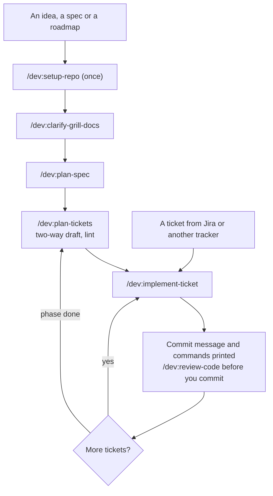

<div align="center">


# Skills for Standard Developer

**From an empty source, or a ticket in a big project, to delivery.**

[](https://code.claude.com/docs/en/plugins)
[](CHANGELOG.md)
[](https://nodejs.org)
[](LICENSE)

[Quick start](#quick-start) · [How it works](#how-it-works) · [Skills](#skills) · [Changelog](#changelog)

</div>

---

38 small skills for Claude Code: agree on what to build, cut it into tickets, prove it works, remember what the last session learned. Skills with a common job share a prefix: type `/dev:clarify-` or `/dev:test-` to list them.

## Why this plugin

- **Proof, not claims.** A ticket is done when a command on the real code says `VERIFIED`.
- **Process sized to risk.** A one-line change runs the existing build. Stored data, outside callers and money get tests per risk and an Impact review.
- **Plans checked before code.** Larger epics are drafted two ways and compared; every breakdown is linted.
- **You stay in control.** Skills print commit, push and tracker commands for you to run.
- **Memory across sessions.** Issues, attempts, fixes and decisions live in a local SQLite store.

## Quick start

```bash
claude plugin marketplace add nhhthong/skills
claude plugin install dev@nhhthong-skills
```

Then, inside your project:

```text
/dev:setup-repo                      once per repo: storage, delivery, tracker
/dev:implement-ticket <ticket text>  take one ticket to a printed commit
/dev:ask-me <what you want to do>    not sure? get the skills to run, in order
```

> **Requires** [Node.js](https://nodejs.org) 22.18+ for the memory server. Without it, skills still work and memory falls back to `.work/notes.md`.

## How it works



`/dev:implement-ticket` runs eight steps (identify, orient, fill the gaps, plan the proof, build, review, deliver, close) and writes a `Step:` line before each, so a dead session resumes with the same command.

The proof tier decides how much runs:

| Tier | When | What runs |
|---|---|---|
| `check` | A mistake shows at a glance; a revert undoes it | The repo's existing command |
| `light` | As above, one behaviour worth keeping | One test, a baseline of the touched area |
| `full` | Data stored or sent, outside caller, money, auth | Tests per risk, full-suite baseline, Impact and Adversary review |

## Skills

Prefix every name with `/dev:`. **You type** skills run only when called. **Agent** skills also start on their own.

<details>
<summary><b>Setup</b>: prepare a repo, a machine and a way to drive the app (3)</summary>

- [`setup-repo`](skills/setup-repo/SKILL.md) (you type): Choose storage, delivery, issue tracker and domain docs.
- [`setup-need-install`](skills/setup-need-install/SKILL.md) (you type): Recommend helper tools to add.
- [`setup-verify`](skills/setup-verify/SKILL.md) (you type): Generate a skill that drives the real app; `refresh` updates it.

</details>

<details>
<summary><b>Clarify</b>: agree on what to build (5)</summary>

- [`clarify-grill-docs`](skills/clarify-grill-docs/SKILL.md) (you type): Interview until the design settles; record terms and decisions.
- [`clarify-ask`](skills/clarify-ask/SKILL.md) (you type): Turn a question into a questionnaire for someone else.
- [`clarify-explain`](skills/clarify-explain/SKILL.md) (you type): Re-pitch a message that did not land.
- [`clarify-grill`](skills/clarify-grill/SKILL.md) (agent): The interview: rounds of questions with recommended answers.
- [`clarify-domain`](skills/clarify-domain/SKILL.md) (agent): Challenge terms, record each term and decision once.

</details>

<details>
<summary><b>Explore</b>: answer a question before building (5)</summary>

- [`explore-decide`](skills/explore-decide/SKILL.md) (agent): Research a technical choice, recommend one option.
- [`explore-how`](skills/explore-how/SKILL.md) (agent): Explain how a part of the code works.
- [`explore-research`](skills/explore-research/SKILL.md) (agent): Cited findings from primary sources.
- [`explore-prototype`](skills/explore-prototype/SKILL.md) (agent): Throwaway prototype for a design question.
- [`explore-why`](skills/explore-why/SKILL.md) (agent): Why code is shaped this way, known kept apart from inferred.

</details>

<details>
<summary><b>Plan</b>: from source to tickets (3)</summary>

- [`plan-spec`](skills/plan-spec/SKILL.md) (you type): Spec index or full spec; open points stay open.
- [`plan-tickets`](skills/plan-tickets/SKILL.md) (you type): Epics and tracer-bullet tickets, drafted two ways and linted.
- [`plan-ticket-change`](skills/plan-ticket-change/SKILL.md) (you type): Split, cancel or reopen a ticket.

</details>

<details>
<summary><b>Implement</b>: build (2)</summary>

- [`implement-ticket`](skills/implement-ticket/SKILL.md) (you type): One ticket to a printed commit; resumes.
- [`implement-spec`](skills/implement-spec/SKILL.md) (you type): A whole spec with parallel subagents.

</details>

<details>
<summary><b>Test</b>: right-sized proof (3)</summary>

- [`test-plan`](skills/test-plan/SKILL.md) (agent): The minimum proof a ticket needs.
- [`test-tdd`](skills/test-tdd/SKILL.md) (agent): Red-green, one slice at a time.
- [`test-benchmark`](skills/test-benchmark/SKILL.md) (agent): Vet a performance number before reporting it.

</details>

<details>
<summary><b>Debug</b>: find the cause of a hard bug (1)</summary>

- [`debug-diagnose`](skills/debug-diagnose/SKILL.md) (agent): Red loop, hypotheses, fix, recorded attempts.

</details>

<details>
<summary><b>Review</b>: check the work (4)</summary>

- [`review-code`](skills/review-code/SKILL.md) (you type): Standards and Spec, plus Impact and Adversary for risky changes, in parallel subagents.
- [`review-impact`](skills/review-impact/SKILL.md) (agent): What a change breaks outside its diff, proven by running code.
- [`review-learn`](skills/review-learn/SKILL.md) (you type): Learning note for a finished ticket or epic.
- [`review-pr`](skills/review-pr/SKILL.md) (agent): PR body: summary visual, evidence, merge danger.

</details>

<details>
<summary><b>Design</b>: deep modules, clean seams, honest types (3)</summary>

- [`design-improve`](skills/design-improve/SKILL.md) (you type): Find modules to deepen and walk through one.
- [`design-modules`](skills/design-modules/SKILL.md) (agent): Vocabulary for deep modules and seams, with red flags.
- [`design-types`](skills/design-types/SKILL.md) (agent): TypeScript type discipline; loads on `.ts` files.

</details>

<details>
<summary><b>Session</b>: status, handoff, retrospective (3)</summary>

- [`session-progress`](skills/session-progress/SKILL.md) (you type): Where the work stands and what is next.
- [`session-handoff`](skills/session-handoff/SKILL.md) (you type): A document another agent can continue from.
- [`session-retro`](skills/session-retro/SKILL.md) (you type): Improve the agent's environment, most severe first.

</details>

<details>
<summary><b>Memo</b>: remember and recall across sessions (2)</summary>

- [`memo-post`](skills/memo-post/SKILL.md) (agent): Record an issue, attempt, fix, decision or lesson.
- [`memo-callback`](skills/memo-callback/SKILL.md) (agent): Search earlier ones by question, ticket, epic or file.

</details>

<details>
<summary><b>Other</b>: navigation, manual steps, writing for agents (4)</summary>

- [`help`](skills/help/SKILL.md) (you type): One line per skill, for all or one group.
- [`ask-me`](skills/ask-me/SKILL.md) (you type): Say what you want, get the skills to run.
- [`wizard`](skills/wizard/SKILL.md) (you type): A script for steps only a human can do.
- [`agent-docs`](skills/agent-docs/SKILL.md) (agent): Write skills, `CLAUDE.md` and other agent documents.

</details>

## What needs you

| | |
|---|---|
| **Skills ask you** | for an ambiguous requirement, a real choice, `setup-repo`, `setup-need-install`, `session-retro`, and the `Always pause` list: deleting data, shared-database migration, force-push, deploy, customer message |
| **Skills print, you run** | `git commit`, `git push` (set `Git writes: run` in `workflow.md` to change), and every `gh` or `glab` write |
| **Skills just do** | read code and history, write under `.work/`, run tests and builds, create branches and worktrees |

## Files the skills write

Tickets, spec index, plans, proof scripts and notes go under `.work/`. Under `private` storage `.work/` stays out of git and nothing else is touched.

## Memory

The local MCP server `memo` keeps issues, attempts, fixes and decisions in SQLite at `~/.claude/memo/`, one file per project. No network. Back up with `node mcp/memo/cli.ts export`.

## Changelog

<details>
<summary><b>2.1.0</b> (2026-10-28): sharper proof, how and why, adversarial review</summary>

- New skills `explore-how` and `design-types`.
- `review-code` adds an Adversary axis: only findings a rerun proves are kept.
- A proof counts only once seen to fail; `explore-why` grades claims in five tiers.
- `Models:` line in `workflow.md` sets the model per kind of subagent.
- Memory survives a renamed clone; ticket lint fixed for several edge cases.

</details>

<details>
<summary><b>2.0.1</b> (2026-10-27): fewer stops, more accurate plans</summary>

- Skills ask only on ambiguity or a real choice.
- `plan-tickets` drafts two ways, compares, lints (`check-tickets.mts`).
- Tickets carry `Files:` and `Proof:`; `gh` and `glab` writes are always printed.

</details>

<details>
<summary><b>2.0.0</b> (2026-10-27): proof-first skills from pstack</summary>

- New skills `review-impact`, `explore-why`, `test-benchmark`, `setup-verify`.
- Rigor follows the ticket's tier; `review-code` adds Impact.

</details>

Full history: [CHANGELOG.md](CHANGELOG.md).

## Development

```bash
npm install && npm test   # skill consistency check, then the script tests
```

`npm test` names whatever a new skill is missing: `SKILL.md`, `agents/openai.yaml`, or its line in `plugin.json`, `skills/help/SKILLS.md` and this README.

## Credits

- [Matt Pocock's skills](https://github.com/mattpocock/skills) (MIT): the base of this repo.
- [pstack](https://github.com/cursor/plugins/tree/main/pstack) by Lauren Tan (MIT): proof levels, tiers, leaf files, two-way planning, and the skills behind `review-impact`, `explore-why`, `explore-how`, `test-benchmark` and `setup-verify`.

## License

[MIT](LICENSE). Copyright (c) 2026 Matt Pocock and nhhthong.
