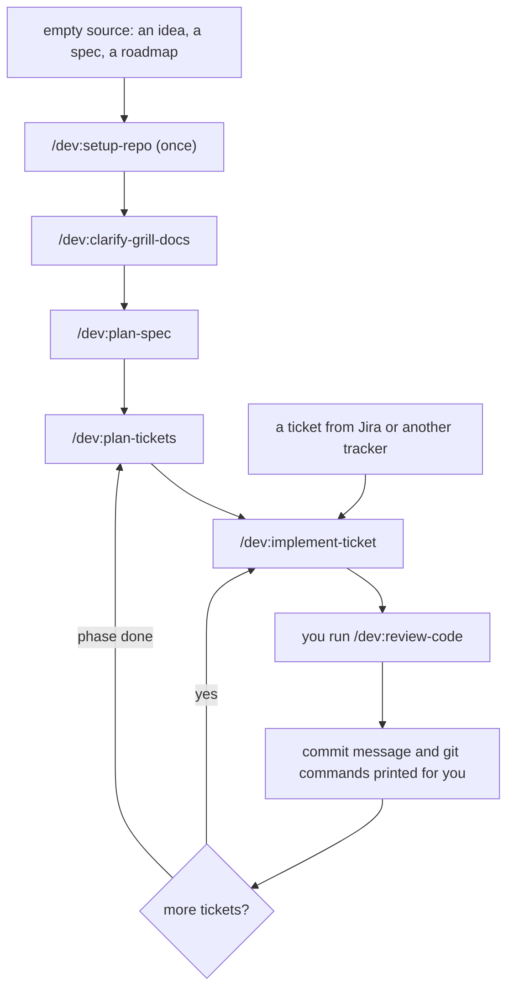

# Skills for Standard Developer

**From an empty source, or a ticket in a big project, to delivery.**

[](https://code.claude.com/docs/en/plugins)
[](.claude-plugin/plugin.json)
[](LICENSE)

30 small skills for Claude Code that help you agree on what to build, cut it into tickets, prove it works, and remember what the last session learned. Skills with a common job share a prefix: type `/dev:clarify-` or `/dev:test-` to list them.


## Install

```bash
claude plugin marketplace add nhhthong/skills
claude plugin install dev@nhhthong-skills
```

**Requirements:** [Node.js](https://nodejs.org) 22.18 or newer (24 recommended). The `memo` server and the script templates are TypeScript that Node runs directly: no build step, no `npm install`, no packages. Without Node the skills still work, and memory falls back to `.work/notes.md`.


## How it works



`/dev:implement-ticket` takes one ticket through: identify, orient in the code, fill the gaps, plan the proof (an existing command, one test, or tests per risk; some tickets need none), build, review, deliver. It writes a `Step:` line before each stage, so a dead session resumes with `/dev:implement-ticket`.

**By default, skills never run `git commit` or `git push`.** They print the commit message and the exact commands for you to run. Set `Git writes: run` in `workflow.md` to change that.

## Use it

| Your situation | Commands |
|---|---|
| An idea and an empty folder | `setup-repo` → `clarify-grill-docs` → `plan-spec` → `plan-tickets` → `implement-ticket` |
| A roadmap that already has phases | Same, but `plan-spec` indexes the roadmap by requirement code instead of copying it, and `plan-tickets` cuts only the next phase |
| A Jira ticket in a company repo | `setup-repo` (private, pr), then `implement-ticket` with the ticket text pasted as the argument |
| A hard bug | Describe or paste the error; `debug-diagnose` starts by itself |
| Back the next day | `session-progress` to see where things stand, then `implement-ticket` with no argument |
| Many independent tickets in a phase | `implement-spec` (parallel worktrees; you run the printed integration script) |
| A ticket needs information only another person has | `clarify-ask` writes a questionnaire for them |
| Choose between options (database, queue, library) | `explore-decide` researches and recommends; you choose |
| Not sure where to start | `ask-me <what you want to do>` names the skills to run; `ask` lists them all |

Run `clarify-grill-docs`, `plan-spec` and `plan-tickets` in one session, then start each `implement-ticket` in a fresh one. Anything the source leaves open stays an open point with a name and a date; skills never fill it with a guess.

## Skills

Prefix every name with `/dev:`. **You type** skills run only when you call them. **Agent** skills the agent also reaches for on its own when the task fits. Open a group to see its skills.

<details>
<summary><b>Setup</b>: Prepare a repo and a machine (2)</summary>

- [`setup-repo`](skills/setup-repo/SKILL.md) (you type): Choose where memory lives (in the repo or private), how work is delivered, the issue tracker and domain docs.
- [`setup-need-install`](skills/setup-need-install/SKILL.md) (you type): Check which helper tools are installed, look at the project, and recommend which to add.

</details>

<details>
<summary><b>Clarify</b>: Agree on what to build (5)</summary>

- [`clarify-grill-docs`](skills/clarify-grill-docs/SKILL.md) (you type): Interview you until the design is settled, building a shared language and recording decisions as they settle.
- [`clarify-ask`](skills/clarify-ask/SKILL.md) (you type): Turn a question you cannot answer alone into a questionnaire for the person who can.
- [`clarify-explain`](skills/clarify-explain/SKILL.md) (you type): Ask the agent to re-pitch a message that did not land, in plain English and the project's terms.
- [`clarify-grill`](skills/clarify-grill/SKILL.md) (agent): The interview itself: rounds of questions, each with a recommended answer.
- [`clarify-domain`](skills/clarify-domain/SKILL.md) (agent): Challenge terms against the glossary, test edge cases, and record each term and decision once.

</details>

<details>
<summary><b>Explore</b>: Answer a question before building (3)</summary>

- [`explore-decide`](skills/explore-decide/SKILL.md) (agent): Research a technical choice and recommend one option; also picks infrastructure one component at a time.
- [`explore-research`](skills/explore-research/SKILL.md) (agent): Investigate a question against primary sources and save cited findings; uses Context7 first when present.
- [`explore-prototype`](skills/explore-prototype/SKILL.md) (agent): Build a throwaway prototype to answer a design question.

</details>

<details>
<summary><b>Plan</b>: From source to tickets (2)</summary>

- [`plan-spec`](skills/plan-spec/SKILL.md) (you type): Index a structured source by requirement code, or write a full spec from a conversation; open points stay open.
- [`plan-tickets`](skills/plan-tickets/SKILL.md) (you type): Cut epics if needed, then tracer-bullet tickets with types, requirement codes and blocking edges.

</details>

<details>
<summary><b>Implement</b>: Build (2)</summary>

- [`implement-ticket`](skills/implement-ticket/SKILL.md) (you type): Take one ticket from orientation to a printed commit message and commands; resumes unfinished work.
- [`implement-spec`](skills/implement-spec/SKILL.md) (you type): Implement a whole spec with parallel subagents, one frontier at a time.

</details>

<details>
<summary><b>Test</b>: Right-sized proof (2)</summary>

- [`test-plan`](skills/test-plan/SKILL.md) (agent): Choose the minimum proof a ticket needs: an existing command, one test, or tests per risk.
- [`test-tdd`](skills/test-tdd/SKILL.md) (agent): Red-green-refactor one slice at a time, at agreed seams.

</details>

<details>
<summary><b>Debug</b>: Find the cause of a hard bug (1)</summary>

- [`debug-diagnose`](skills/debug-diagnose/SKILL.md) (agent): Build a loop that goes red on the bug, then minimise, hypothesise, fix, and record every attempt.

</details>

<details>
<summary><b>Review</b>: Check the work (2)</summary>

- [`review-code`](skills/review-code/SKILL.md) (you type): Review a diff on two axes, Standards and Spec, in parallel subagents.
- [`review-pr`](skills/review-pr/SKILL.md) (agent): Shape a pull request body: a summary visual, before and after evidence, merge danger.

</details>

<details>
<summary><b>Design</b>: Deep modules, clean seams (2)</summary>

- [`design-improve`](skills/design-improve/SKILL.md) (you type): Scan the code for places to deepen modules and walk through the one you pick.
- [`design-modules`](skills/design-modules/SKILL.md) (agent): The vocabulary for deep modules, seams and testable interfaces.

</details>

<details>
<summary><b>Session</b>: Status, handoff, retrospective (3)</summary>

- [`session-progress`](skills/session-progress/SKILL.md) (you type): Report where the work stands, what is open, what looks wrong and what to do next.
- [`session-handoff`](skills/session-handoff/SKILL.md) (you type): Compact the conversation into a document another agent can continue from.
- [`session-retro`](skills/session-retro/SKILL.md) (you type): After a session, suggest improvements to the agent's environment, most severe first.

</details>

<details>
<summary><b>Memo</b>: Remember and recall across sessions (2)</summary>

- [`memo-post`](skills/memo-post/SKILL.md) (agent or you): Record an issue, a tried approach, a fix, a decision with its reason, or a lesson.
- [`memo-callback`](skills/memo-callback/SKILL.md) (agent or you): Search earlier issues, fixes, decisions and notes by question, ticket, epic or file.

</details>

<details>
<summary><b>Other</b>: Navigation, manual steps, writing for agents (4)</summary>

- [`ask`](skills/ask/SKILL.md) (you type): Show what each skill does, one line each, for all or one group.
- [`ask-me`](skills/ask-me/SKILL.md) (you type): Say what you want to do and get the skills to run, in order.
- [`wizard`](skills/wizard/SKILL.md) (you type): Generate an interactive script that walks you through steps only a human can do.
- [`agent-docs`](skills/agent-docs/SKILL.md) (agent): Write skills, `CLAUDE.md` and other documents agents read.

</details>

## What the skills write

Work files live under `.work/` in the project:

```text
.work/
├── config.md          # private storage only: tracker, domain, workflow
├── spec-index.md      # requirement codes, open points, decisions, infrastructure order
├── tickets/           # <epic>/, external/ (pasted tickets), tracked/ (tracker copies)
└── questionnaires/
```

Under `private` storage, skills create nothing else in the repository.

## Memory

The plugin starts a small MCP server, `memo`, that keeps what sessions learn in a local SQLite database (full-text search, no network). It lives outside the repo at `~/.claude/memo/<project>-<id>.db`, one file per project, found again after a re-clone because the project is identified by its first commit.

| Tool | Does |
| --- | --- |
| `memo_post` | Record an issue (`I-n`), attempt (`A-n`), fix (`F-n`), decision (`D-n`) or note (`N-n`), linked to an epic and a ticket |
| `memo_callback` | Search by question, type, epic, ticket, tag or file, best match first |
| `memo_get` | Read one memo with its linked attempts, fixes and history |
| `memo_info` | Which project and file is in use, counts, open issues |

`debug-diagnose`, `explore-decide`, `clarify-domain` and `implement-ticket` use it on their own. Without Node, skills fall back to `.work/notes.md`. Back up or share with `node mcp/memo/cli.ts export` (run from the plugin folder).

## Development

Only for editing this repo, never for using the plugin: `npm install` adds `@types/node` and TypeScript so the editor and `npm run typecheck` know the `node:*` modules. `npm test` runs the memo server tests.

## Credits

> **Based on [Matt Pocock's skills](https://github.com/mattpocock/skills)** (MIT). Most of the ideas and many of the files come from his work: grilling sessions, a shared domain language, tracer-bullet tickets, red-green-refactor, deep modules and two-axis code review. This repo is maintained on its own and no longer tracks his.

## License

[MIT](LICENSE). Copyright (c) 2026 Matt Pocock and nhhthong.
