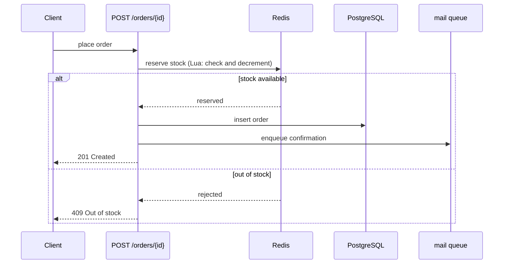
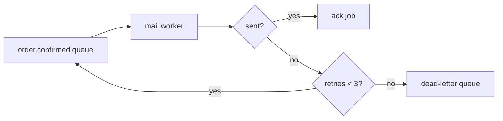

# Example learning note

An illustration of tone and length, not a real ticket. Every name below would come from the code and the ticket in a real note.

````markdown
# EC-7: Place an order without overselling stock

## Summary
Customers place orders for in-stock items; stock never drops below zero, even under heavy concurrent demand.

## Spec
- R2.1: Place an order for an item in stock.
- R2.3: Stock is never negative.

## Expected outcome
- ✅ An order for an in-stock item is accepted and stock decreases by the ordered quantity.
- ✅ Concurrent orders for the last unit: exactly one succeeds, the others get `409 Out of stock`.
- ✅ A confirmation email is sent after the order is stored.

## Case study
1,000 customers order the last unit of one item at the same moment. A plain read-then-write lets many requests read `stock = 1` and all decrement it, so stock ends at -999. The reservation is a single atomic Redis operation (Lua script): check and decrement happen in one step, so only one request can take the last unit.

## Install
- Redis 7: atomic stock reservation.

## Implementation

### `POST /orders/{id}`
Reserves stock in Redis, stores the order in PostgreSQL, then queues the confirmation email. Lives in `internal/order/handler.go`.



### Mail queue
A worker reads `order.confirmed` jobs and sends the email; a failed send is retried three times, then moved to the dead-letter queue. Lives in `internal/mail/worker.go`.



## Decisions and lessons
- D-4: Reserve stock in Redis, not with a database row lock, to keep the hot path off PostgreSQL.
- F-2: A reservation must be released when the database insert fails, or stock leaks; the handler now releases it in the error path.
````
